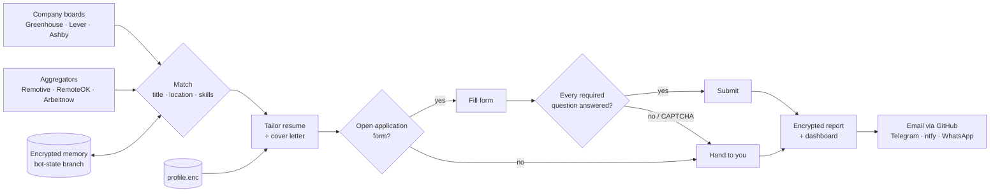

# job_crawler

A bot that runs for free on GitHub Actions: it crawls job boards, tailors your
resume to each matching job, and applies for you where the application form
allows it. Whatever it cannot submit lands in a short report with the tailored
PDF and the link, so finishing by hand takes a minute.



## What it does on every run

1. **Crawl** – public JSON APIs of company boards on Greenhouse, Lever and Ashby
   (list in `config.yml`), plus the Remotive, RemoteOK and Arbeitnow aggregators.
2. **Match** – job title must contain one of your target titles, location must
   fit, then jobs are ranked by overlap with your skills. Jobs handled before
   (or the same role in another city) are skipped.
3. **Tailor** – reorders your skills and picks the most relevant bullets for
   each job, and rewrites the two-line summary. It can only *select and reorder
   what is already in your profile*; a summary that mentions anything your
   profile lacks is thrown away. Works by keyword matching out of the box, and
   with an AI model if you add a free API key (below).
4. **Cover letter** – written per job under the same rule (facts from your
   profile only; anything else falls back to a plain template), as PDF and text.
5. **Apply** – opens the Greenhouse/Lever/Ashby form in headless Chromium, fills
   it from your profile and your `answers`, uploads the tailored resume and
   cover letter and submits – but only if every required question has an answer.
6. **Remember** – every handled job is recorded (encrypted) so it is not applied
   to twice within `reapply_after_days`; multiple-choice answers the AI gave are
   reused so the same question always gets the same answer; questions that stop
   forms are counted so the report can tell you which one to teach it next.
7. **Notify** – a phone alert (Telegram, ntfy or WhatsApp) the moment a form
   needs you (CAPTCHA, verification code), a daily log after every run, an encrypted zip
   (workflow artifact) and, optionally, an email with the PDFs attached.

## Setup (about 10 minutes, once)

Your profile (resume, search criteria, answers, notification tokens) can live in
either of two places. Both keep it out of public view.

**Option A – encrypted file in the repo (recommended).** The profile is committed
as `profile.enc`, which is unreadable without a key; the key is the only secret.

```bash
python -m jobbot.seal new-key
```

Store the printed key as the repository secret **`JOBBOT_KEY`**
(Settings → Secrets and variables → Actions). Then, with `profile.yml` filled in
from `profile.example.yml`:

```bash
JOBBOT_KEY=<key> python -m jobbot.seal seal
```

Commit `profile.enc`. To change the profile later, `seal open`, edit, `seal seal`,
commit. `profile.yml` is git-ignored and must never be committed.

**Option B – everything in a secret.** Paste the whole `profile.yml` into a
secret named **`PROFILE_YAML`**. Nothing personal is in the repo at all.

A secret gist is *not* an option: gists are only unlisted, anyone with the link
can read them, and they are not encrypted.

Then:

1. Run the **jobbot** workflow from the Actions tab. It starts in dry-run mode:
   forms are filled but nothing is submitted.
2. Download the `jobbot-report` artifact from the run and open it with your
   `state_key` as the zip password (use 7-Zip / Keka / `7z x`; the zip is
   AES-encrypted). Check the tailored PDFs and the "Teach the bot" list.
3. When it looks right, set `apply.dry_run: false` in `config.yml`. From then on
   it runs every weekday by itself.

That is the only required manual input. Optional: phone alerts (below) and your
own company lists in `config.yml`.

### Notifications

**Works with no setup:** the bot keeps an issue called "jobbot inbox" in this
repository and comments on it – the daily log after each run, and immediately
when an application needs you. GitHub emails you each comment. Because the
repository is public, comments contain counts only ("submitted 4, need you 2
(1 captcha)") plus a link to the run's encrypted report; set
`github_inbox: {details: true}` in your profile if you would rather have job
titles and links right in the email.

For richer alerts add any of these to your profile (all free):

| Channel | Setup | Notes |
|---|---|---|
| **Telegram** (recommended) | In Telegram, message **@BotFather** → `/newbot` → copy the token. Then send your new bot any message (e.g. "hi"). Add `telegram: {token: "..."}` to the profile. | Instant, reliable, and the alert includes the tailored resume and cover letter as PDFs. |
| **ntfy** | Install the ntfy app, subscribe to a long random topic name. Add `ntfy: {topic: "that-name"}`. | No account at all. Anyone who knows the topic can read it, so make it unguessable. |
| **WhatsApp** | Send `I allow callmebot to send me messages` to the number on [CallMeBot](https://www.callmebot.com/blog/free-api-whatsapp-messages/), add `whatsapp: {phone, apikey}`. | CallMeBot is the only free WhatsApp route and is often full ("check back in a few days"). |
| **Email** | `smtp:` block with a Gmail **app password** (Google Account → Security → 2-Step Verification → App passwords). Your normal password will not work. | Alerts and the daily report arrive with the PDFs attached. |

There is no free, dependable SMS route (Indian carriers have no email-to-SMS
gateway and the free SMS APIs are US-only or one message a day).

You then get:

- **an alert as soon as a form stops at a CAPTCHA or asks for an emailed code**,
  with the job and the link to finish it;
- **a daily log** after each run: what was submitted, what needs you (with
  links), and which questions to add to `answers:`.

A CAPTCHA cannot be solved *through* a chat app: it is bound to the browser
session on GitHub's runner, which is gone by the time you read the message. The
alert is your cue to open the link and finish that one application yourself,
with the tailored PDFs already on your phone (Telegram or email).

## What is in the report

Each run uploads `jobbot-report` (an AES-encrypted zip; the password is your
`state_key`):

- `dashboard.html` – totals, applications per day, outcome of every job in the
  run, the questions that stop forms most often, and the full history.
- `report.md` – the same run as text, with a "Teach the bot" list.
- one folder per job with the tailored resume and cover letter (PDF and text).

## What will still need you

No bot can honestly promise 100% unattended applications:

| Situation | What the bot does |
|---|---|
| Form shows a CAPTCHA or asks for an emailed verification code | Stops, puts the job in "Needs you". It never tries to defeat these. |
| Required question it cannot answer from your profile | Stops and lists the question under "Teach the bot". Add one regex to `answers:` and that question is automated from then on. |
| Aggregator job that links to some other website | Tailors the resume and gives you the link. |
| LinkedIn, Naukri, Glassdoor, Indeed and other login-walled sites | Not automated, on purpose – see below. |

### Why the bot does not log in to LinkedIn, Naukri or Glassdoor

These sites forbid automated accounts and applications in their terms, verify
sign-ups by phone OTP, and actively detect bots. Getting past that means
disguising the bot, and the usual result is a restricted or banned account –
on LinkedIn that would cost you far more than the applications gain. The bot
therefore applies only where a company publishes its own open application form,
and for everything else prepares the tailored resume and cover letter so the
manual step is a one-minute upload.

Expect the manual share to shrink over the first week as your `answers:` grow.

## Privacy in a public repo

- Your resume, search criteria and answers exist only encrypted (`profile.enc`) or in the `PROFILE_YAML` secret.
- The bot's memory (`bot-state` branch) and the report artifact are encrypted
  with your `state_key`.
- Workflow logs contain counts only – no names, companies or questions.
- The workflow has no pull-request trigger, so forks cannot reach the secret.

## Cost

$0. Actions minutes are free for public repositories and all job sources are
free public APIs. The AI is optional and uses a free-tier key you supply; if its
quota runs out mid-run the bot carries on with keyword tailoring. Use is still
subject to GitHub's Actions terms and each site's terms; the pace is deliberate
(`max_per_run`, `max_per_company`, `delay_seconds`).

### Optional: AI tailoring (one free API key)

GitHub Models, which the bot first used, was retired in July 2026. Any
OpenAI-compatible API with a free tier works instead – Google Gemini, Groq or
OpenRouter. Create a key (links in `profile.example.yml`), add

```yaml
llm:
  provider: gemini
  api_key: "your-key"
```

to your profile and re-seal it. The bot asks the provider which models exist and
picks one, so there is no model name to keep up to date. With a model, resumes
and cover letters read better and the bot can answer open-ended questions
("Why do you want to work here?") from your real experience – the main reason
forms otherwise stop for manual input. Your resume text is sent to that provider.

## Roadmap

- More sources with public APIs: SmartRecruiters, Workable, Recruitee, Teamtailor.
- Job-alert emails (LinkedIn, Naukri, Glassdoor alerts sent to your inbox) read
  over IMAP and queued with tailored documents – coverage of those sites
  without automating them.
- Automatic discovery of which applicant-tracking system a company uses.
- Outcome tracking: reply and rejection detection from the inbox.

## Running locally

```bash
pip install -r requirements.txt pytest && playwright install chromium
python -m pytest -q                 # unit tests + form-filling tests on local fixtures
python -m jobbot --demo --limit 3   # fake profile against live boards, never submits
python -m jobbot --dry-run          # your profile.yml (git-ignored), never submits
```

## Layout

| Path | Purpose |
|---|---|
| `config.yml` | sources, thresholds, caps, dry-run switch |
| `profile.example.yml` | template for your profile |
| `profile.enc` | your profile, encrypted |
| `jobbot/sources.py` | job board API clients |
| `jobbot/match.py` | filtering and scoring |
| `jobbot/tailor.py` | truthful resume tailoring |
| `jobbot/apply.py` | label-driven form filler and submitter |
| `jobbot/cover.py` | cover letters |
| `jobbot/notify.py` | phone alerts and daily log (Telegram, ntfy, WhatsApp) |
| `jobbot/seal.py` | encrypt / decrypt the in-repo profile |
| `jobbot/state.py`, `jobbot/report.py` | encrypted memory, report, email |
| `.github/workflows/jobbot.yml` | the scheduled run |
| `.github/workflows/ci.yml` | tests plus a dry-run canary against live boards |
